# Проєктування v1.0

## Use Case Diagram

Відповідає на питання: хто взаємодіє із системою і для чого. Один актор —
Репетитор, сім варіантів використання в межах v1.0; UC3 включає перевірку
перетину часу. Повні текстові специфікації — у `use-cases.md`.

## Class Diagram

Відповідає на питання: які предметні сутності, атрибути та зв'язки
потрібні для реалізації v1.0. Модель навмисно не показує технічні класи
майбутньої реалізації (репозиторії, сервіси) — лише предметну структуру.

`Student` — учень: ідентифікатор, повне ім'я, телефон, нотатки.
`Consultation` — запис на консультацію: прив'язаний до одного `Student`
(`StudentId`), має дату/час початку, тривалість, статус, тему і нотатку.
Один `Student` може мати багато `Consultation` (1:0..*). `ConsultationStatus`
— перелічення трьох станів запису.

## State Machine Diagram

Відповідає на питання: які стани має важливий об'єкт і які переходи
дозволені. У v1.0 такий об'єкт — `Consultation`: дозволена поведінка
прямо залежить від її статусу (не можна повторно завершити, скасована
консультація звільняє час). `Student` змістовного життєвого циклу в
v1.0 не має — його дані можна редагувати в будь-який момент без обмежень
за станом, тому окрему State Machine Diagram для нього не створено.

Запис створюється одразу у стані `Scheduled` (UC3). З нього можливі два
переходи: до `Completed` через UC5 (обов'язково з темою) або до
`Cancelled` через UC4. Обидва — кінцеві стани: назад у `Scheduled`
повернути запис не можна. Лише записи у стані `Scheduled` враховуються
при перевірці перетину часу (FR-04) — саме тому скасування «звільняє»
слот.

## Activity Diagram (індивідуальні)

Кожен учасник деталізував Activity Diagram для власного Use Case
безпосередньо в Markdown (Mermaid-код зберігається в Git разом з
документацією):

- UC-03 «Створити запис на консультацію» — `model/activity-uc3.md` (Вадим)
- UC-01 «Зареєструвати учня» — `model/activity-uc1.md` (Максим)
- UC-05 «Позначити заняття проведеним» — `model/activity-uc5.md` (Олександр)

## Матриця простежуваності

Повна таблиця — у `traceability.md`.
