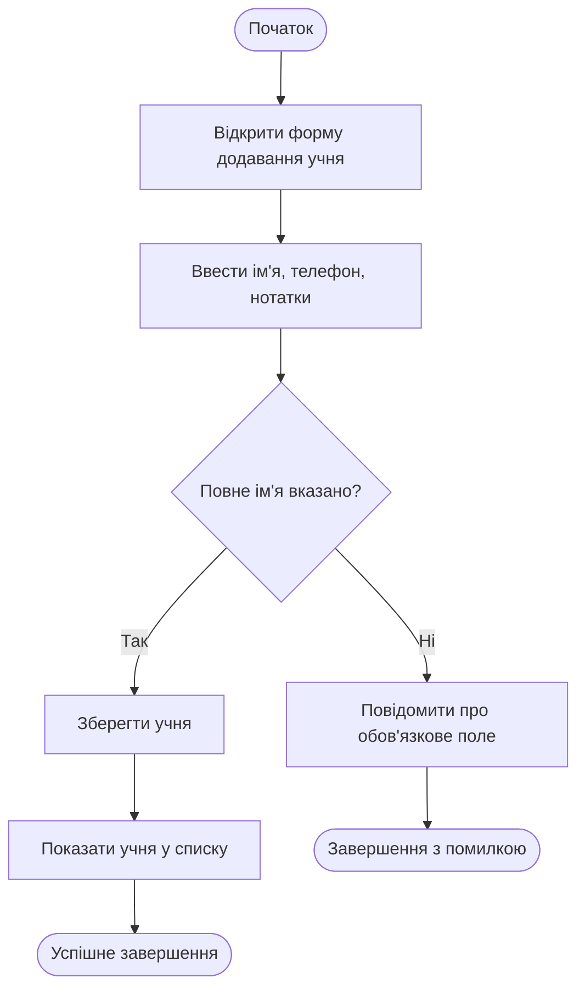

# Activity Diagram — UC1 «Зареєструвати учня»

Автор: Максим.

| Крок специфікації UC1 | Елемент Activity Diagram |
|---|---|
| 1–2. Відкриття форми, введення даних | Послідовні дії на початку діаграми |
| 3. Перевірка обов'язковості імені | Вузол рішення «Повне ім'я вказано?»; гілка «Ні» веде до повідомлення про помилку |
| 4–5. Збереження і показ у списку | Успішна гілка після проходження перевірки |
