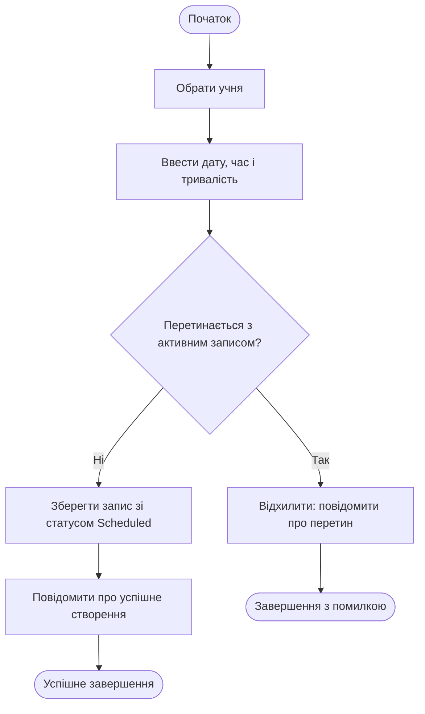

# Activity Diagram — UC3 «Створити запис на консультацію»

Автор: Вадим.

| Крок специфікації UC3 | Елемент Activity Diagram |
|---|---|
| 1–2. Вибір учня, введення дати/часу/тривалості | Послідовні дії на початку діаграми |
| 3. Перевірка перетину часу (include «Перевірити перетин часу») | Вузол рішення «Перетинається з активним записом?»; гілка «Так» веде до відхилення |
| 4–5. Збереження і підтвердження | Успішна гілка після проходження перевірки |
