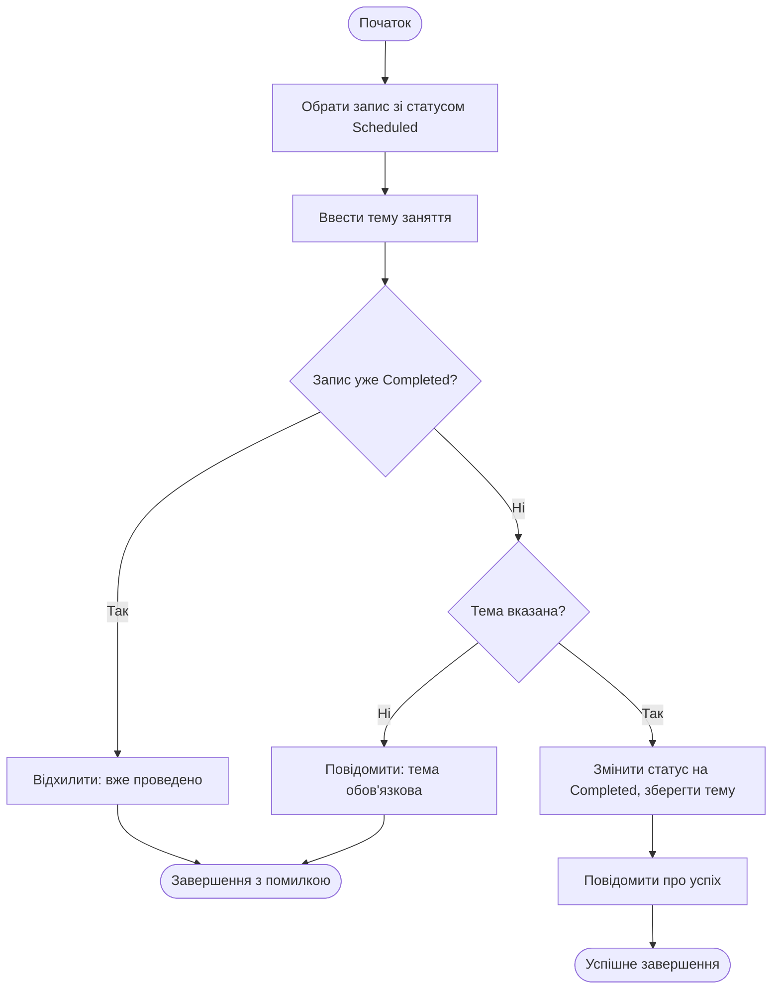

# Activity Diagram — UC5 «Позначити заняття проведеним»

Автор: Олександр.

| Крок специфікації UC5 | Елемент Activity Diagram |
|---|---|
| 1–2. Вибір запису, введення теми | Послідовні дії на початку діаграми |
| 3. Перевірка повторного завершення і наявності теми | Два вузли рішення; обидві гілки «ні/не вказано» ведуть до відхилення |
| 4–5. Зміна статусу і підтвердження | Успішна гілка після проходження обох перевірок |
